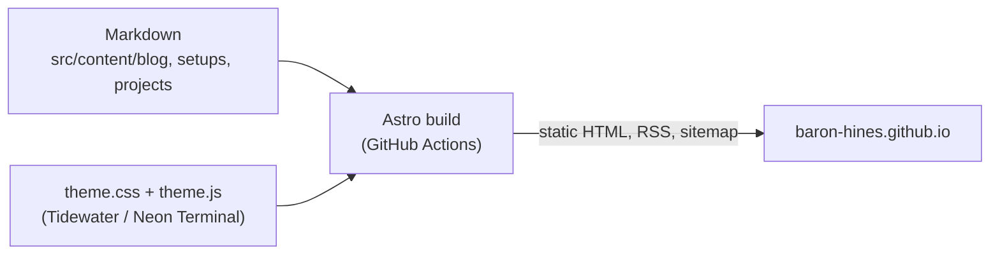

# Plan: a blog, setups and projects on baron-hines.github.io

Goal: turn https://baron-hines.github.io/ from three hand-written HTML pages into a small site with three sections: **blog** posts, **setups** (how the owner's machines and AI tooling are wired together) and **projects**. It keeps the Tidewater (light) and Neon Terminal (dark) theming merged in [#1](https://github.com/baron-hines/baron-hines.github.io/pull/1). Every page is written in Markdown, the build runs in GitHub Actions, and the pages that are there today keep their exact URLs.

"Not many bells and whistles" is the brief. The site ships no JavaScript except the existing theme toggle and, only on pages that have a diagram, Mermaid. Every extra in D6 costs nothing at runtime.

**Pinned against:** `main@b2c248c`.

---

## Owner involvement

**Level:** Agent-run for the build and the design. **Owner-approved for content**, because anything under blog, setups or projects publishes the owner's writing. The agent merges its own PRs for Phases 1 and 2 once checks are green and the previous deploy has finished. Phase 3's content PRs wait for the owner's approval.

**Owner steps:**

| Phase | What the owner does | Why it's theirs |
|---|---|---|
| 1 | Nothing. The agent switches the Pages source to GitHub Actions with `gh api` as part of this plan. | |
| 2 | Looks at the preview screenshots in the PR (both modes, phone width) and says if anything is off. Optional. | It's the owner's design system. |
| 3 | Picks which projects are listed. Reviews and approves the first setup page and the first post before they merge. | It publishes the owner's work and writing. Some repos are private. |

**The agent stops and asks when:** a check keeps failing after two fixes; `oscar-wallpaper/` or `oscar-wallpaper/privacy.html` would stop answering at their current URL, even briefly; a setup page would need a detail the privacy rule (D7) forbids; or a choice comes up that the Decisions don't cover.

## Decisions

Proposed 2026-11-26, for the owner's review.

| # | Date | Decision | Why |
|---|---|---|---|
| D1 | 2026-11-26 | Build with **Astro** (7.x, pinned in `package-lock.json`), static output only. | It turns Markdown into pages and ships no JavaScript unless a page asks for some. **Content collections** give each section a schema for its front matter (title, date, tags, status), so a typo'd date or a missing title fails the build instead of producing a broken page. RSS is a first-party add-on. If a setup page later wants something interactive, a component can do that without changing tools. Eleventy would also work but has no schemas. Hugo's templates are harder to change. Jekyll is pinned to old versions on Pages. |
| D2 | 2026-11-26 | **URLs:** `/blog/<slug>/`, `/setups/<slug>/`, `/projects/<slug>/`, each with an index page. `build.format: 'preserve'`, so `oscar-wallpaper/index.astro` builds `/oscar-wallpaper/index.html` and `privacy.astro` builds `privacy.html`. | `https://baron-hines.github.io/oscar-wallpaper/` and `.../privacy.html` are the homepage and privacy-policy URLs on oscar-wallpaper's Google OAuth consent screen (oscar's wallpaper plan). If they move, the published app goes out of compliance. `'preserve'` maps source files to output files one-to-one, so those two can't drift. |
| D3 | 2026-11-26 | **Sections:** a *post* has `title`, `date`, `summary`, `tags`, `draft`. A *setup* has `title`, `summary`, `updated` and no date in the URL, because it's a living page that gets edited. A *project* has `title`, `summary`, `status` (active, paused, done), `repo` (optional, public repos only), `links`, `tags`. The home page shows the latest three posts, every setup, and active projects. | Posts are dated and read once. Setups are reference pages that change. Projects are a portfolio. Giving each its own shape keeps the index pages simple and lets the home page pick from each. |
| D4 | 2026-11-26 | **Theme:** `theme.css` and `theme.js` move to `src/styles/` and `public/`, unchanged at first. One `BaseLayout` holds `<head>`, the header and the footer. The light/dark toggle moves into the header nav. New pieces follow the design docs: Tidewater uses `radius-card`, `shadow-raised` and pill tags (`cyan-100` with `cyan-900` text). Neon Terminal uses square `panel` cards with a `line` border, `glow-panel` and bracketed tags (`[active]`), with section labels written as `// projects`. | Each design system says how cards, tags and labels look, so the components follow those rules. Nothing new is invented. The tokens already switch on `data-theme`, so a component only references tokens and works in both modes. |
| D5 | 2026-11-26 | **Wording** stays plain sentence case in the Markdown. Neon Terminal's uppercase headings, bracketed status words and `//` labels come from CSS (`text-transform`, `::before`) and the components, not from the text. | Tidewater wants sentence case and Neon Terminal wants shell-style text. The same Markdown has to read right in both, so the dark mode's styling is applied on top. |
| D6 | 2026-11-26 | **Extras, all with zero runtime cost:** (a) code highlighting with Shiki's two-theme output, colored from the same tokens as the Forgejo theme files in oscar (`docker/forgejo/themes/`); (b) Mermaid diagrams in Markdown, rendered in the browser and **loaded only on pages that have one**, redrawn with the token colors when the theme toggles; (c) an RSS feed for the blog; (d) a sitemap at `/sitemap.xml`, written as a small endpoint (`@astrojs/sitemap` guessed URLs from route names and listed `/oscar-wallpaper/privacy` instead of `privacy.html`); (e) Open Graph tags so links unfurl with a title and summary in Discord and elsewhere; (f) a themed 404 page; (g) CSS-only page transitions (`@view-transition { navigation: auto; }`), which browsers without support simply skip. | These make the site feel finished without adding things to maintain. Mermaid matters because the setup pages will want the same kind of diagrams oscar's plans already use. It's loaded only where it's used because it's large (around 700 kB). Search, comments and tag pages are left for later (Future work) until there's enough content to need them. |
| D7 | 2026-11-26 | **Privacy rule for setup pages:** describe the architecture (which tools, how they connect, why) but never private IPs, LAN hostnames and ports, usernames, email addresses, account or App IDs, key paths, or token names. A CI step fails the build if the output contains a private IPv4 address (`10.`, `172.16–31.`, `192.168.`), an email address, or a token prefix (`ghp_`, `github_pat_`, `sk-`). | oscar's docs are full of these details, and drafting setup pages from them is how they'd leak. The site is public and gets cached. A grep in CI catches the slips a review might miss. |
| D8 | 2026-11-26 | **Deploy:** one workflow, `.github/workflows/deploy.yml`. Pull requests run `astro check`, the build and D7's check. Pushes to `main` also deploy through `actions/upload-pages-artifact` and `actions/deploy-pages`. The Pages source changes from `legacy` to `workflow` (`gh api -X PUT repos/baron-hines/baron-hines.github.io/pages -f build_type=workflow`) in the same step as the first deploy. Node is pinned to the current LTS in `.nvmrc`. | PRs get a real check before they publish anything. Today's `legacy` build runs Jekyll on whatever is pushed, which would publish Astro's source files instead of the built site. |
| D9 | 2026-11-26 | **Drafts:** `draft: true` keeps a post out of production builds but shows it in `npm run dev`. | The owner, or an agent, can push an unfinished post on its branch without publishing it. |

## Effects on the rest of the system

- **oscar-wallpaper's Google OAuth verification:** depends on the two URLs in D2. Phase 1 checks both after the switch, and checks them again after every later phase.
- **oscar's wallpaper plan** links the site. The links still work (D2).
- **This repo** gains a `package.json`, `src/`, `public/` and a workflow. The `plans/` folder stays outside `src/`, so it is never published. Until Phase 1 ships, `_config.yml` keeps Jekyll from publishing it.
- **oscar, spiff, penguin:** no changes. This repo isn't one of the three template siblings, so their shared layout rules don't bind it, apart from `plans/` (see open questions).

## Phases

### Phase 1: Astro in place, nothing visibly changes

**Owner:** nothing.

1. One PR: scaffold Astro (D1), add `BaseLayout`, move `theme.css`/`theme.js` across (D4), rebuild the three existing pages as `.astro` files with the same content, add the workflow (D8) and D7's check, and remove `_config.yml`.
2. Once green, the agent switches the Pages source to `workflow`, merges, and watches the first deploy.
3. If the deploy fails, the agent reverts the merge on `main` and switches the source back to `legacy`. Both are needed: `legacy` builds whatever `main` holds, so on its own it would publish Astro's source files. The fix then goes in a new PR.

- [x] PR checks run `astro check`, build and the privacy grep.
- [x] The Pages source is `workflow` and the first deploy succeeded.
- [x] `/`, `/oscar-wallpaper/` and `/oscar-wallpaper/privacy.html` return 200 and look as they do today in both modes.

*Done 2026-11-26* in [#3](https://github.com/baron-hines/baron-hines.github.io/pull/3). The privacy check was tested against a planted file with a `192.168.x.x` address, an email address and a `ghp_` token, and caught all three.

### Phase 2: sections, components and extras

**Owner:** glance at the screenshots (optional).

1. One PR: the three content collections and their schemas (D3, D9), index and detail pages for each, the header nav with the toggle, cards, tags, section labels (D4, D5), and D6's extras. Each section ships with one example entry marked `draft: true`, so the production site shows empty-state text ("No posts yet") rather than placeholder content.
2. The PR includes screenshots of the home page, a project card and a post with code and a Mermaid diagram, in both modes and at phone width (375 px).
3. The agent merges it once green.

- [x] Each section's index and detail page builds, with drafts hidden in production.
- [x] Code blocks and Mermaid diagrams switch colors with the toggle.
- [x] `/rss.xml` and `/sitemap.xml` are served, and every page has Open Graph title and description tags. (How a link unfurls in Discord gets checked when a page is first shared there.)
- [x] No horizontal scroll at 375 px. Text passes 4.5:1 contrast in both modes.

*Done 2026-11-26.* Two things the plan didn't expect: Mermaid uses a `.label` class internally, so the section-label style is named `.section-label`; and the dev server reports paths without the trailing slash, so the layout normalizes the path before marking the current nav link.

### Phase 3: what we already have

**Owner:** picks the project list; approves the content PR.

1. The agent lists the owner's repos with their visibility and proposes a project list (for example oscar, the wallpaper tool, kiosk's model benchmark, the themes). **The owner picks** which go in.
2. One content PR:
   - **Projects:** one entry per picked project. oscar-wallpaper's entry links to its existing pages (D2) rather than replacing them.
   - **Setups:** "How my AI is strung together", drafted from oscar's README and docs: Claude Code on the PC, oscar's coding agent (OpenHands and opencode through LiteLLM, started by issue labels), the GitHub Apps that sign its work, n8n, and how they hand work to each other. It gets a Mermaid diagram and follows D7.
   - **Blog:** one first post. The default is "Theming this site", on the Tidewater/Neon Terminal pairing from [#1](https://github.com/baron-hines/baron-hines.github.io/pull/1), because it's already done and needs no new research.
3. **(owner)** Review and approve. The agent merges once approved and green.

- [x] The owner picked the projects: **AI coding stack** (one entry for LiteLLM, n8n, the models and the coding agent; the owner merges this one), and **themes** and **kiosk** as placeholders with no source links, since both repos stay private for now. The Ruby and Roundhouse repos are left out for now.
- [x] The Local AI stack page passes D7's check and the owner's review, and is live.

*Changed 2026-11-26 (owner):* no setup page and no first post for now. The "How my AI is strung together" draft is folded into the AI coding stack project page, which is renamed **Local AI stack** (`/projects/local-ai-stack/`), and the "Theming this site" post is dropped. Blog and Setups show their empty states until there's something to put in them.

*Done 2026-11-27* in [#5](https://github.com/baron-hines/baron-hines.github.io/pull/5), merged by the owner. `/projects/local-ai-stack/`, `/projects/themes/` and `/projects/kiosk/` are live, and the Local AI stack page's two diagrams draw on the live site.

## Later changes

- **2026-11-27 (owner):** the Setups section is removed. The site has two sections, Blog and Projects. The home page shows only the latest posts. oscar-wallpaper is listed as a project, and its two pages keep their URLs (D2).

## Open questions

| Question | Default until answered |
|---|---|
| Is "Agent-run for build, owner-approved for content" the right level? | Yes, as proposed under Owner involvement. |
| Should this plan live here, or in oscar's `plans/` with the others? | Here, in a `plans/` folder that follows the oscar/spiff/penguin layout, because it's about this repo. |
| A custom domain? | No. `baron-hines.github.io` stays. Moving it would also mean updating the OAuth consent screen (D2). |
| Analytics? | None. oscar-wallpaper's privacy page already promises no analytics, and the site doesn't need them. |
| Add the shared `AGENTS.md` here so oscar's coding agent and other tools follow the attribution rule? | No for now. Only Claude Code works in this repo, and its rules are global. |

## Future work

| # | What | Size |
|---|---|---|
| F1 | Search with Pagefind (built at deploy time, loaded only when the search box is opened), once there are around 15 pages. | S |
| F2 | Tag pages (`/tags/<tag>/`) across all three sections. | S |
| F3 | Comments on posts through giscus (GitHub Discussions). | S |
| F4 | Project cards that pull the last commit date and description from the GitHub API at build time. | S |
| F5 | A "now" page: what the owner is working on this month. | S |

## Progress

- [x] Phase 1: Astro in place, Pages deploys from Actions, existing URLs unchanged
- [x] Phase 2: sections, components and extras merged; checked in both modes and at phone width
- [x] **(owner)** Phase 3: projects picked; Local AI stack page approved and live
