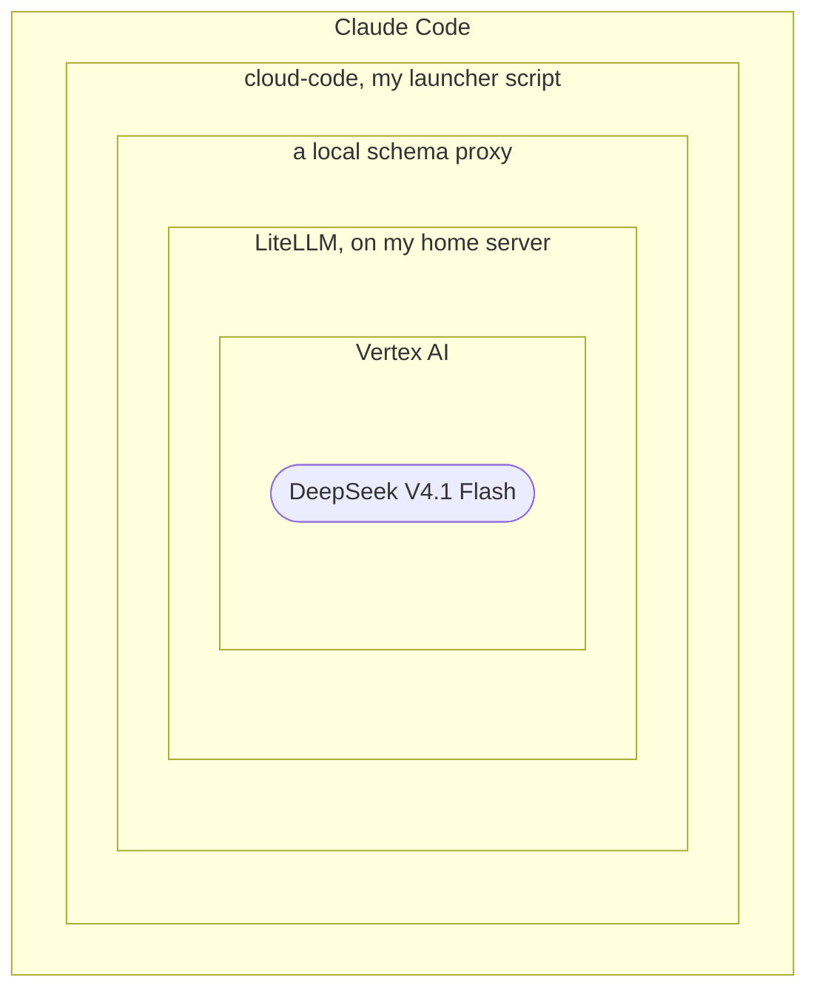

I wanted Claude Code's agent loop running on a cheaper model that I control, with a budget and a log of every request. The model I picked is DeepSeek V4.1 Flash, served by Google's Vertex AI. Claude Code doesn't talk to Vertex, so every request goes through a few other programs first.

Here is the path a single request takes, drawn as what it is, an onion:



Each layer speaks its own dialect. Claude Code speaks Anthropic's Messages API. LiteLLM turns that into OpenAI's chat format for Vertex. DeepSeek writes its tool calls in its own markup, called DSML, and something on Vertex's side turns those back into JSON. A tool call crosses four formats on the way in and the same four on the way out.

Across 15 sessions, 15.0% of DeepSeek's 1,208 tool calls failed. Claude, doing the same kind of work in the same tool, failed 3.8% of 22,080. I assumed the model was the problem. Mostly it wasn't. Here are the layers from the outside in, and what each one did to me.

## Claude Code

The first thing I noticed was the context meter. I'd read a file of about 100 tokens and the meter at the bottom would jump past 64%.

My first guess was a lying meter. Proxies sometimes count cached tokens twice, so I sent the same request twice and compared the usage LiteLLM reported. The second reply said 25 new input tokens and 3,584 cached, which adds up to the 3,609 of the first. The meter was honest.

The tokens were real. A one-word prompt cost 44,073 input tokens. As far as I can tell, with Anthropic's own API Claude Code sends only the names of most tools and loads a tool's full schema when it needs one. Against any other backend, it sends every schema in full, on every request. I caught one request with a throwaway local listener and measured it. It held 40 tools and 148,000 characters of JSON schema. The claude.ai Artifact tools alone were about 70,000 characters, roughly 18,000 tokens, and they can't work through LiteLLM at all.

Claude Code has a `--disallowedTools` flag, and it removes tools from the request, not just from what the model may call. Turning off 12 tools I never use there brought the same one-word prompt down to 20,042 tokens. It was the cheapest fix of the week. I deleted things.

## The launcher

`cloud-code` is a PowerShell script that checks LiteLLM is up, reads the key's budget, starts the local proxy and then runs `claude`. It's glue code, and glue code breaks too.

This command failed:

```text
cloud-code -NoWorktree -p "Reply with just OK" --output-format json
The key can't use '--output-format'. It may use: cloud-manual-coder
```

PowerShell binds arguments it doesn't recognize to parameters by position. `--output-format` isn't a PowerShell-style parameter, so it landed in `-Model`. A bare prompt like `cloud-code "fix the tests"` would have done the same. The fix was to stop using a `param()` block and match the script's own options by exact name, passing everything else to `claude` in order.

This isn't an AI bug. I mention it because every layer adds code like this, and that code has bugs of its own.

## The schema proxy

This layer exists only to keep two other layers compatible. Some of Claude Code's tool schemas contain regular expressions with lookahead or lookbehind, like `(?=` or `(?<!`. The grammar compiler on Vertex rejects those, and the whole request fails. A small Python proxy on my PC strips those patterns from each request before it goes out and passes everything else through untouched.

So the request leaves my PC already changed once, before the gateway even sees it.

## LiteLLM

LiteLLM is the gateway on my home server, and it's the layer that made the rest fixable. Callers ask for an alias like `cloud-manual-coder`, never a vendor's model name, so swapping DeepSeek out later is one line of config. Each tool gets its own key with a monthly budget, so a runaway loop costs at most that budget.

It's also where a fix can go once and reach every caller. My coding agent and Claude Code both use DeepSeek through it. This week I gave both aliases a default temperature and added a callback that cleans DeepSeek's markup out of tool arguments, and both clients got them without a change on their side.

It's also another translator, and it changes requests without saying so. Claude Code asks for extended thinking on every request. LiteLLM translates that into a `reasoning_effort` parameter, and because my config has `drop_params: true`, it then drops that parameter for this model without a word. In 2,369 DeepSeek replies, not one had any reasoning in it, and nothing anywhere said why.

When I turned reasoning on deliberately, it got worse. On two tool calls with escaping that's easy to get wrong, reasoning off produced 104 exact results out of 105. Reasoning on produced 98 out of 110. On the harder of the two, the median latency went from 2.9 seconds to 13.6, the slowest took 65, and three runs thought until they hit the 4,000-token limit without ever making the call. It stayed off.

## Vertex and DeepSeek's markup

The next layer in is where DeepSeek's own markup appeared. In 67 of the 1,208 calls, DeepSeek's DSML tags ended up inside the arguments instead of being parsed out. One Bash call came through as:

```text
grep -n 'CHANGELOG' README.md | head -20</｜DSML｜parameter>Nope.</｜DSML｜parameter>
</invoke></｜DSML｜parameter>Grep tool instead:</｜DSML｜parameter>
```

The shell then tried to run all of that. My coding agent, which uses the same model through the same gateway, had the leak in 7.3% of its calls.

The first sign of this wasn't an error message. My analysis script crashed while printing samples, with `UnicodeEncodeError: 'charmap' codec can't encode character '\uff5c'`. That character is the fullwidth vertical bar DeepSeek uses in its special tokens, and Windows' default console encoding can't print it. The crash told me what to search for.

I also chased a false alarm. Error messages from failed calls showed commands like `2›/dev/null`, with a look-alike bracket where `>` belonged, which would break every shell redirect. I checked every call that had parsed, and none of them contained one. The `›` came from Claude Code's error message, which rewrites `>` when it quotes your input. One layer's way of displaying a problem had made it look like a different problem.

The cleanup callback in LiteLLM now cuts the markup out. It cuts only when DeepSeek's bar character is in the string, because an Edit that really contains a `</parameter>` tag should reach the file as written.

## DeepSeek's habits

Most of the 15.0% wasn't malformed calls. When I sorted the 181 errors by kind, these were the biggest:

| Kind | Errors |
|---|---|
| Refused by Claude Code's worktree guard | 29 |
| Path not found | 29 |
| Command ran and failed | 29 |
| DSML markup in the arguments | 28 |
| Arguments that weren't valid JSON | 15 |
| File too big for one Read | 11 |

The worktree refusals are the strangest. Each session works in its own git worktree, and Claude Code refuses commands it can't prove stay inside it. DeepSeek kept writing `cd "C:/…/worktrees/<name>" && …`, changing into the folder it was already in, and Claude Code refused the whole command each time. Claude doesn't write commands like that, so the guard had never been a problem before. Neither side was broken. DeepSeek writes commands in a way Claude Code wasn't built to expect. A five-line note appended to the system prompt now tells it not to `cd`, to use relative paths and to run one command per call.

## The loop

Then I gave it a real job, building a phase of one of my plans, and it got stuck. Its first task was to update a card on my kanban board with a description from the plan. It called the board's `update_task` tool about 25 times in a row. Every call said it was setting the description. Every call that arrived carried only the card's id and title. Every call succeeded, because a call without a description is a valid update. The model could see it was looping and said so, then made the same call again.

It started a few minutes after I'd deployed the LiteLLM changes above, so I went after my own changes first, peeling from the outside in:

1. The system-prompt note? The same request with and without it dropped the description 12 times out of 12.
2. The new default temperature? Every temperature from 0.3 to 1.0 dropped it.
3. The cleanup callback? Its log and its metric were empty. It had never fired.
4. Then the test that settled it. I called Vertex through the LiteLLM library inside the container, which skips the gateway and everything I'd added to it. It still dropped the description.

So it was inside the two layers I don't control, Vertex's parsing and the model. From outside I can't tell which of the two. Narrowing it down by parameter name gave a strange result:

| Parameter name | Kept |
|---|---|
| `notes`, `text`, `summary`, `note` | 3 of 3 |
| `description`, `body`, `content`, `details`, `comment` | 0 of 3 |

The same calls had worked the evening before. The last good one I can find was at 21:31 UTC. My deploy was at 00:38 and the loop at 00:42. The timing pointed at me, and it was wrong.

What made this the worst bug of the week is that nothing failed. A malformed call gets an error, and the model tries something else. A call with an argument missing gets "Updated", and the model has nothing to correct.

## Working around it

I can't fix Vertex, but I can change what I hand it. Claude Code's Write tool takes a `content` argument, and in my tests it came through every time, even though a bare parameter called `content` didn't. So the prompt now tells the agent to skip the board's tools. It writes the card's markdown to a file, builds the JSON with a one-line Python command and sends it to the board's HTTP API with curl. Then it reads the card back and compares it with the plan. In 8 tries, the text came through exactly every time.

On the second run, with that change, the same model got past the board.

## What I'd tell someone stacking these tools

Count your failures before you tune anything. Claude Code keeps every session as a transcript, and a short script that sorts tool errors by kind told me more than a week of watching sessions did.

To find the layer at fault, go around it. Calling the next layer down directly and comparing the result answered questions that reading configs never did.

Distrust timing. The loop began four minutes after my deploy and had nothing to do with it.

Prefer a layer that fails loudly. A missing argument that reports success cost me more time than every malformed call put together.

Delete what you don't need. Twelve unused tools were more than half of every request.

## Where it stands

The tool cleanup, the prompt note, the temperature default and the markup cleanup are all live. I'll rerun the error count on the sessions since then and update this post with the numbers. I'm also lining up a comparison with other models behind the same alias. With LiteLLM in the middle, trying one costs a line of config.

The rest of the setup is on the [Local AI stack](/projects/local-ai-stack/) page.
