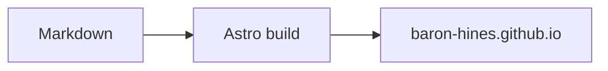

This post is a **draft**, so it only shows up in `npm run dev`. It exists to check how a post looks in both themes. Delete it once real posts are in.

## Code

```ts
// Shiki colors come from the theme tokens, so they switch with the toggle.
export function greet(name: string): string {
  const greeting = `hello, ${name}`;
  return greeting.length > 40 ? "hello" : greeting;
}
```

Inline code looks like `npm run build`.

## A diagram



## Other bits

> A quote, for when one is needed.

- A list item
- Another, with a [link](https://astro.build/)

| Column | Another |
|---|---|
| A table cell | 42 |
