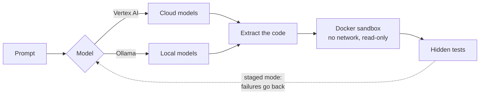
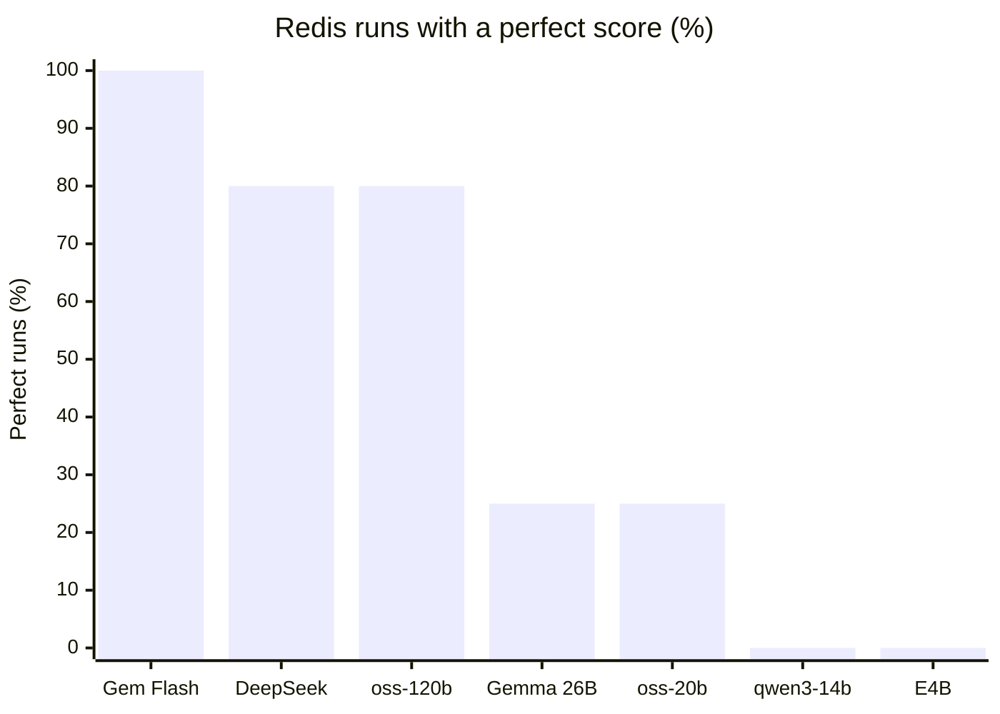
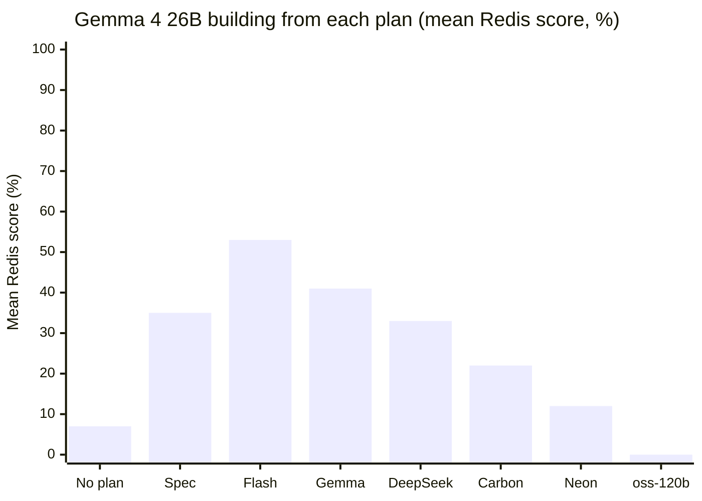
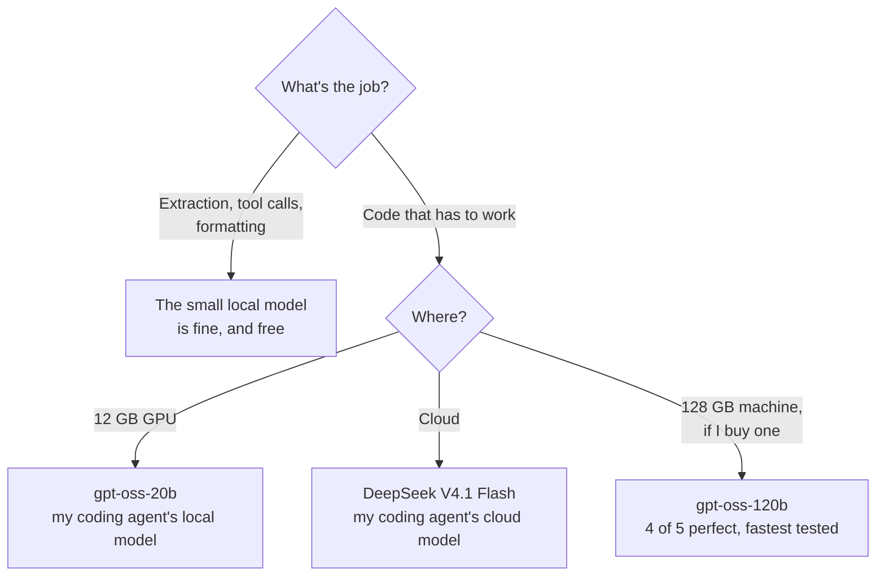

I wanted a coding agent running on my own hardware, which raised two questions. Which model can actually write working code on the GPU I have? And when the local model isn't enough, which cloud model gives the most working code per dollar? kiosk was a short, scripted benchmark to answer both. It ran from November 23 to 26, 2026, on Google Cloud's $300 trial credit, and spent about $10 of it.

**The answer:** **gpt-oss-20b** is the local coder, and **DeepSeek V4.1 Flash** is the cloud one. They're now the `coder` and `coder-cloud` models in my [local AI stack](/projects/local-ai-stack/).

## How it worked

Every model got the same prompts. Its answer was pulled out, run inside a locked-down Docker container (no network, read-only, CPU and memory limits), and scored by hidden tests. Nothing was graded by eye, and every zero was checked by hand to make sure the model failed, not the grader.

There were three kinds of test:

| Test | What the model does | How it's scored |
|---|---|---|
| **Light suite** | Five small tasks: write a protocol parser, fix three hidden bugs, extract invoice JSON, follow strict formatting rules, call tools in the right order | Hidden unit tests, five runs per task |
| **Redis challenge** | Write a working Redis-compatible server in one Python file | 41 tests over a real TCP socket: protocol edge cases, 50 concurrent clients, persistence across a restart. Out of 100 |
| **Planning test** | Write a plan for the Redis server. A fixed second model builds it from the plan alone, never seeing the spec | The Redis tests score the result. Two judge models also score the plan |

The Redis challenge ran two ways. **Single-shot** gives the whole spec in one message. **Staged** works in five steps: after each step the tests run, and failures go back to the model with two chances to fix them.

The models covered three hardware tiers, using the cloud to stand in for machines I don't have:

| Model | Stands in for | Where it ran |
|---|---|---|
| gpt-oss-20b, qwen3-coder-30b, qwen3-14b | My 12 GB laptop GPU | Locally, on Ollama |
| gemma4 E4B (128k context) | My everyday small local model | Locally, on Ollama |
| Gemma 4 26B | A 24 GB machine | Vertex AI |
| gpt-oss-120b | A 128 GB machine | Vertex AI |
| DeepSeek V4.1 Flash | Too big to run locally | Vertex AI |
| Gemini 3.8 Flash, Gemini 4 Neon / Carbon | Paid reference models | Vertex AI |

## Results

### Can it build a working Redis server?

The share of Redis attempts that passed all 41 tests:

| Model | Single-shot | Staged | Perfect runs |
|---|---|---|---|
| Gemini 3.8 Flash | 100, 100, 100 | 100, 100 | 5 of 5 |
| DeepSeek V4.1 Flash | 100, 100, 100 | 100, 89 | 4 of 5 |
| gpt-oss-120b | 100, 100, 88 | 100, 100 | 4 of 5 |
| Gemma 4 26B | 9, 0, 96 | 11, 0, 2, 100, 100 | 2 of 8 |
| gpt-oss-20b (local) | 96, 96, 36 | 100 | 1 of 4 |
| qwen3-14b (local) | 67, 0, 0 | not run | 0 of 3 |
| gemma4 E4B (local) | 0, 0, 0 | 0, 0 | 0 of 5 |

**Scores are all-or-nothing.** Most runs either worked completely or failed early, so the table lists every run instead of an average that would describe a "50-point model" that never existed. The failures were real bugs. One model compared command names as bytes against strings, so every command came back "unknown". Another named a method `del`, which Python won't parse. Another assumed each network read holds exactly one whole command.

### Quality against cost

| Model | Cost per Redis attempt | Cost per perfect Redis server |
|---|---|---|
| gpt-oss-120b | $0.0019 | about $0.005 |
| DeepSeek V4.1 Flash | $0.0038 | about $0.005 |
| Gemma 4 26B | $0.0019 | about $0.11 (most runs fail) |
| Gemini 3.8 Flash | $0.16 | about $0.15 |
| Local models | $0 | gpt-oss-20b: 1 in 4; the others never |

Gemini 3.8 Flash was the most reliable, but it cost 40 to 85 times more per task. Almost all of that was thinking: it often spent 10,000 to 30,000 tokens reasoning before it answered. DeepSeek and gpt-oss-120b got 4 of 5 perfect servers for a fraction of a cent each.

### Speed on a 12 GB GPU

Locally, **how much of the model fits on the GPU decides speed more than size does**:

| Local model | On the GPU | Output speed |
|---|---|---|
| gemma4 E4B | All of it | 142 tokens/s |
| gpt-oss-20b | 89% | 38 tokens/s |
| qwen3-14b | 65% | 7.5 tokens/s |
| qwen3-coder-30b | Experts in system RAM | 0.5 tokens/s |

qwen3-coder-30b was the best local model at fixing bugs (5 of 5 perfect), but at half a token per second, 25 short tasks took almost six hours. qwen3-14b kept thinking until it hit the 16,000-token limit. That left **gpt-oss-20b as the only local model both good enough and fast enough**: two of its three single-shot Redis servers scored 96, and one staged run reached 100. Its weak spot was list semantics, not the protocol.

### Planning test

The question here was whether a cheap model could build from a plan written by a better one. With a strong builder (Gemini Flash), every plan produced 98–100%, which hid the differences. With a weak builder (Gemma 4 26B), the planners separated (bars are named by who wrote the plan; Flash, Carbon and Neon are the Gemini models):

- **A good plan beat the full spec** for a weak builder: 53% from Gemini Flash's plans against 35% from the raw spec. Ordered steps helped more than extra detail.
- **gpt-oss-120b writes code instead of plans.** 195 lines were cut for breaking the 20-line limit on code blocks, and Gemma couldn't build from what was left.
- **The judges didn't predict what worked.** The plan the judges rated highest ranked fourth when actually built.

## What it decided

- **The coding agent's local model is gpt-oss-20b.** It's the only candidate that fits the GPU well enough to be usable, and it writes mostly working code, though it still needs checking.
- **Its cloud model is DeepSeek V4.1 Flash.** It matched gpt-oss-120b's reliability at about half a cent per working server, it doesn't think out loud, and it starts answering in under a second.
- **The small local model stays** for structured work. It scored 100% on extraction and tool calls, but zero on every Redis attempt.
- **For future hardware,** gpt-oss-120b on a 128 GB machine would get cloud-level results locally. It's the strongest argument for buying one.

## Caveats

- **Small samples:** 3 to 5 runs per model per test. That's enough to see big gaps, not to rank close models.
- **Cloud weights aren't quantized.** A 4-bit local copy of the same model may score a little lower.
- **Gaps:** the Gemini 4 models were mostly blocked by capacity errors. devstral-small-2 and Qwen3 Coder 480B never ran. Testing ended once the decisions were made.
- **Cost check:** the bill came to $10.02, about 11% above the $8.99 estimated from token counts.

The repo is private for now. These numbers come from its final results report.
