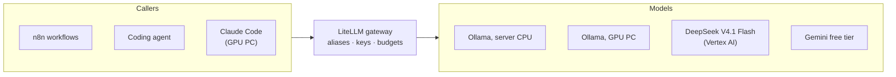
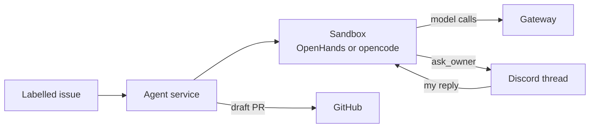

This is the AI side of my home server, and the project I spend most of my time on right now. Everything runs in Docker on the server, except the models on my GPU PC and the cloud ones. Each piece has its own config in git, and merging to `main` deploys it. [Local coding stack](/projects/local-coding-stack/) covers how that code gets written, checked and deployed.

Everything that talks to a model goes through one gateway. The callers are workflows, a coding agent, and Claude Code. The gateway decides which model actually answers. Callers ask for a role, like "a coder" or "something to name media files", and I can change the model behind that role without touching them.

Claude Code on my desktop is the one exception: it talks to Anthropic directly.

## Models and the gateway

[LiteLLM](https://github.com/BerriAI/litellm) gives everything one OpenAI-compatible endpoint, so any tool that can talk to OpenAI can talk to my models.

- **Local models on [Ollama](https://ollama.com/):** small Gemma models on the server's CPU and on the GPU PC, gpt-oss-20b on the GPU PC for local coding, and `nomic-embed-text` for embeddings.
- **Cloud models:** **DeepSeek V4.1 Flash** on Google Cloud Vertex AI for cloud coding, and Gemini's free tier for experiments.

Models are reached by **alias**, not by name:

| Alias | What answers |
|---|---|
| *general, local* | A small Gemma model on the server's CPU |
| *general, GPU* | Gemma with a 128k context on the GPU PC. It falls back to the server's CPU when the PC is asleep. |
| `media-classify` | The model that names media downloads, on the server's CPU, falling back to the GPU PC |
| `embed` | `nomic-embed-text`, on a second Ollama on the server so embedding never pushes the naming model out of memory |
| `coder` | gpt-oss-20b on the GPU PC, the coding agent's local model |
| `coder-cloud` | DeepSeek V4.1 Flash on Vertex AI, the coding agent's cloud model |
| `cloud-manual-coder` | The same DeepSeek model, kept as a separate alias for Claude Code run by hand |

The two cloud aliases have the same model today. They're separate so either one can change without the other.

**Every caller gets its own key.** A key lists the aliases it may use and has a budget that resets every 30 days. When the budget runs out, the gateway refuses that key until the reset, so a runaway loop costs a capped amount. Everything else on Vertex AI is switched off in the gateway's config, so nothing reaches a paid model by accident.

**Postgres** is shared by LiteLLM and n8n and dumped nightly. LiteLLM keeps every prompt and reply there, for a later look at what I actually use these models for.

## Workflows and memory

[n8n](https://n8n.io/) runs the workflows that aren't code:

- **Media naming.** When a download finishes, a workflow asks `media-classify` for the title, year and season, and a small API moves the file into the right library. Anything it isn't sure about is left for me to check.
- **The coding agent's messages** to and from Discord (below).
- **Memory and search tools** for any agent built in n8n, backed by Chroma.

[Chroma](https://www.trychroma.com/) is the vector database behind those tools:

- **Shared memory.** Agents get "remember" and "recall" tools, so what one agent learns, another can find later by meaning. Every memory is tagged by where it came from: something I said, something an agent concluded, or something from a web page, email or file. That last kind is fenced off as untrusted whenever it's recalled.
- **Infrastructure search.** A small service re-indexes my infrastructure repos (docs, configs and scripts, never secrets) within about a minute of a change. A "network lookup" tool answers questions with excerpts that name the repo and file they came from.
- **Off the network.** Chroma has no login, so only n8n's Docker network and scripts on the server itself can reach it.

## The coding agent

To hand a task to the agent, I put a label on a GitHub issue in one of my infrastructure repos. The label picks the local or the cloud model.

1. GitHub's webhook comes in through Tailscale Funnel to a small service on the server, which checks GitHub's signature.
2. The service clones the repo and starts a fresh sandbox container on its own Docker daemon. The agent inside is [OpenHands](https://github.com/All-Hands-AI/OpenHands) or [opencode](https://github.com/sst/opencode). The sandbox has no GitHub credentials and can reach only the gateway and the internet, nothing else on my network. A job gets up to an hour.
3. If the agent needs a decision, it calls an `ask_owner` tool. The question goes through n8n into a Discord thread, and my reply in that thread goes back to the waiting job.
4. When it finishes, the service checks the result. It refuses changes to CI workflows or `.env` files, and changes without a summary. Otherwise it pushes a new branch and opens a **draft** PR that closes the issue. It pushes and comments as its own GitHub App, so I review and approve its PRs like anyone else's.

Every commit the agent makes ends with a trailer naming the tool and the real model behind the alias. Every PR description ends with a matching footer. The service adds them if the agent forgets.

## Claude Code

On my desktop, [Claude Code](https://claude.com/claude-code) is the main way I work: on these repos, on this site, and on the plans behind them. It follows the same attribution rule as the coding agent: every commit and PR says which model wrote it.

On the GPU PC there's a second setup. A `cloud-code` command runs Claude Code against the gateway's `cloud-manual-coder` alias instead of Anthropic's API. That's DeepSeek doing the work through Claude Code's tools, under its own budgeted key.

## Getting in and out

- **[Tailscale](https://tailscale.com/)** is how I reach the server from my phone and laptop, for SSH and for the n8n editor over HTTPS. Neither is open to the internet.
- **Tailscale Funnel** publishes only what has to be public: n8n's production webhook path, and the GitHub webhooks for the coding agent and for repo syncing, which turn away anything without GitHub's signature. The editor and test webhooks stay on a tailnet-only port.
- **The tailnet policy is code.** It lives in its own repo, and CI tests every change on the PR and applies it on merge. CI signs in to Tailscale with GitHub's OIDC identity, so no Tailscale secret is stored anywhere.
- **A Discord bot** keeps one outbound connection, so nothing is exposed for it. It starts a thread per job, and its mentions can only ever reach me.

## Keeping it running

- **CI and deploys:** a self-hosted Forgejo mirrors the repos and runs their checks. A merge deploys only if every check passed, one deploy at a time, and results show on the GitHub PR.
- **Dashboards:** Prometheus and Grafana show requests per model, spend per day, each key's budget, and how many agent jobs are running or waiting on me.

## What's next

- Claude Code opening its PRs as its own GitHub bot, the way the coding agent does, so my approvals mean something on those too.
- Looking through the stored prompts to see which tasks the local models handle well enough and which need the cloud.
