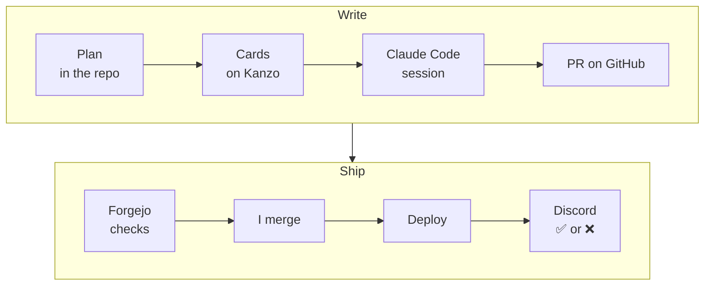
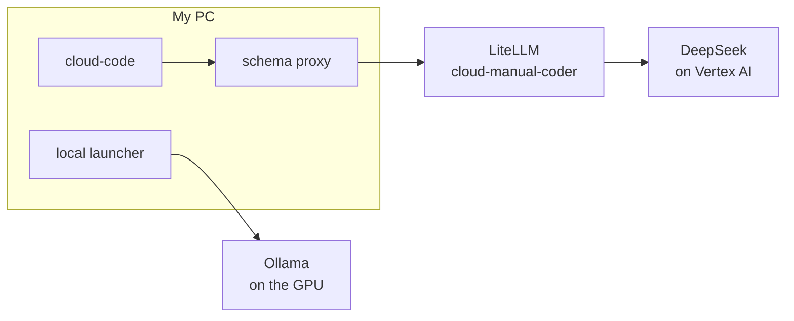
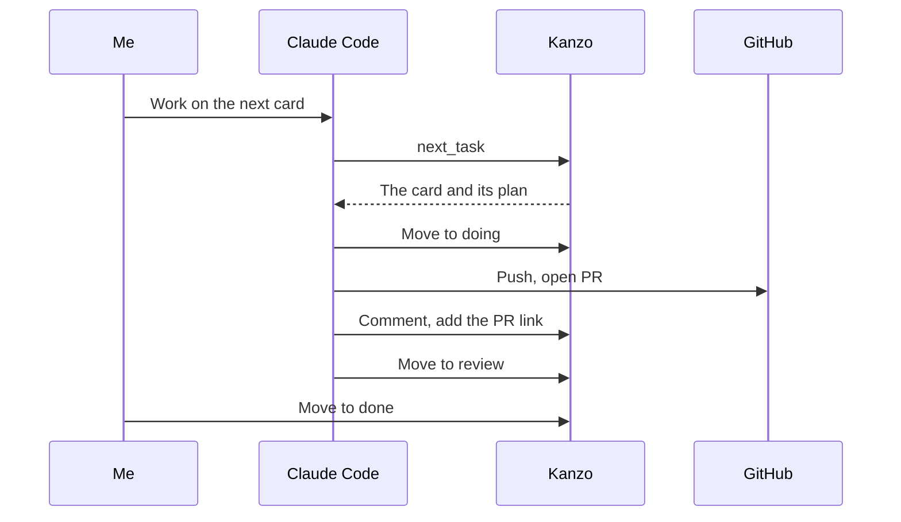
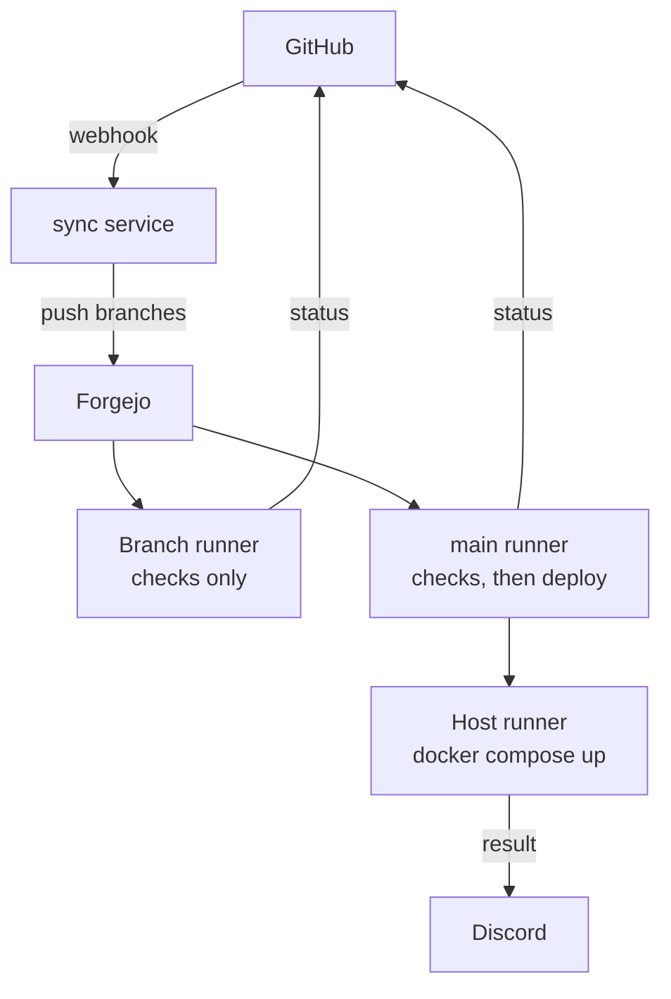
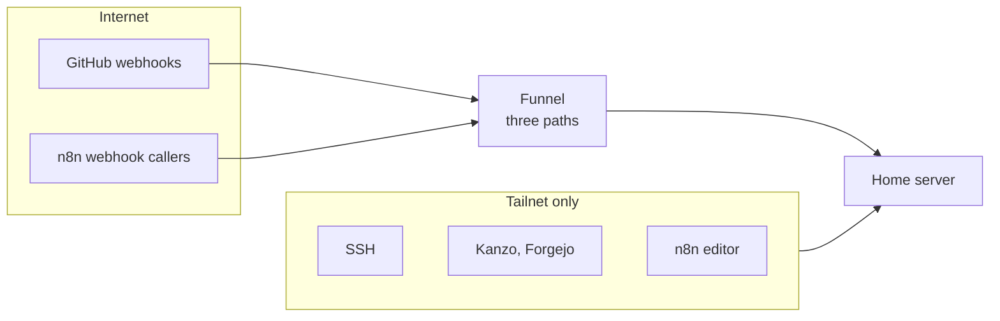

This is how I build things: the home server's repos, the PCs' setup, and this site. Most of the code is written by Claude Code, in sessions I start and steer. Everything around those sessions runs at home: the board that tracks the work, the CI that checks it, and the deploy that ships it. GitHub holds the code and the PRs.

[Local AI stack](/projects/local-ai-stack/) covers the models. This page covers how the work moves.

<figure class="diagram illustration">
<svg viewBox="0 0 720 470" role="img" aria-labelledby="lcs-title lcs-desc">
<title id="lcs-title">The local coding stack at a glance</title>
<desc id="lcs-desc">My PC runs Claude Code, as the desktop app and in a terminal. It talks to Anthropic for the model, to GitHub to push and open PRs, to the Kanzo board over MCP, and, from a terminal, to the LiteLLM gateway. On the home server, Forgejo gets GitHub's webhooks through Tailscale Funnel, runs the checks, reports them back to GitHub, and deploys the Docker stacks. The PC, the server and my phone are on one tailnet.</desc>
<defs>
<marker id="lcs-arrow" viewBox="0 0 10 10" refX="9" refY="5" markerWidth="7" markerHeight="7" orient="auto-start-reverse"><path class="ill-head" d="M0,0 L10,5 L0,10 z"/></marker>
</defs>
<rect class="ill-zone" x="10" y="10" width="700" height="84" rx="10"/>
<text class="ill-zone-label" x="26" y="32">Cloud</text>
<rect class="ill-node" x="40" y="42" width="170" height="40" rx="6"/>
<text class="ill-text" x="125" y="67">Anthropic API</text>
<rect class="ill-node ill-node--key" x="275" y="42" width="170" height="40" rx="6"/>
<text class="ill-text" x="360" y="67">GitHub</text>
<rect class="ill-node" x="510" y="42" width="170" height="40" rx="6"/>
<text class="ill-text" x="595" y="67">Vertex AI</text>
<rect class="ill-tailnet" x="10" y="132" width="700" height="328" rx="12"/>
<text class="ill-zone-label" x="26" y="154">Tailscale tailnet</text>
<rect class="ill-zone" x="30" y="232" width="250" height="148" rx="10"/>
<text class="ill-zone-label" x="46" y="252">My PC</text>
<rect class="ill-node ill-node--key" x="50" y="262" width="210" height="44" rx="6"/>
<text class="ill-text" x="155" y="289">Claude Code app</text>
<rect class="ill-node" x="50" y="320" width="210" height="44" rx="6"/>
<text class="ill-text" x="155" y="347">claude, in a terminal</text>
<rect class="ill-zone" x="30" y="396" width="250" height="48" rx="10"/>
<text class="ill-text" x="155" y="425">Phone, laptop</text>
<rect class="ill-zone" x="440" y="170" width="250" height="274" rx="10"/>
<text class="ill-zone-label" x="674" y="190" text-anchor="end">Home server</text>
<rect class="ill-node ill-node--key" x="460" y="200" width="210" height="44" rx="6"/>
<text class="ill-text" x="565" y="227">Forgejo: CI</text>
<rect class="ill-node ill-node--key" x="460" y="262" width="210" height="44" rx="6"/>
<text class="ill-text" x="565" y="289">Kanzo board</text>
<rect class="ill-node" x="460" y="320" width="210" height="44" rx="6"/>
<text class="ill-text" x="565" y="347">LiteLLM gateway</text>
<rect class="ill-node" x="460" y="382" width="210" height="44" rx="6"/>
<text class="ill-text" x="565" y="409">Docker stacks</text>
<path class="ill-edge" d="M110,262 L110,84" marker-end="url(#lcs-arrow)"/>
<text class="ill-label" x="104" y="190" text-anchor="end">model</text>
<path class="ill-edge" d="M215,262 L320,84" marker-end="url(#lcs-arrow)"/>
<text class="ill-label" x="282" y="190" text-anchor="start">push, PR</text>
<path class="ill-edge" d="M392,84 L492,198" marker-end="url(#lcs-arrow)"/>
<text class="ill-label" x="436" y="150" text-anchor="end">webhook (Funnel)</text>
<path class="ill-edge" d="M532,198 L432,84" marker-end="url(#lcs-arrow)"/>
<text class="ill-label" x="490" y="140" text-anchor="start">checks</text>
<path class="ill-edge" d="M260,284 L458,284" marker-end="url(#lcs-arrow)"/>
<text class="ill-label" x="359" y="276" text-anchor="middle">MCP</text>
<path class="ill-edge" d="M260,342 L458,342" marker-end="url(#lcs-arrow)"/>
<text class="ill-label" x="359" y="334" text-anchor="middle">cloud-code</text>
<path class="ill-edge" d="M670,342 L698,342 L698,62 L682,62" marker-end="url(#lcs-arrow)"/>
<path class="ill-edge" d="M670,222 L684,222 L684,404 L672,404" marker-end="url(#lcs-arrow)"/>
<text class="ill-label" x="676" y="374" text-anchor="end">deploy</text>
<path class="ill-edge ill-edge--soft" d="M280,420 L438,420" marker-end="url(#lcs-arrow)"/>
<text class="ill-label" x="359" y="412" text-anchor="middle">SSH, HTTPS</text>
</svg>
</figure>

Four pieces do the work:

| Piece | What it does here |
|---|---|
| **Claude Code** | Writes the code, as the desktop app's Code tab or the `claude` command in a terminal |
| **[Kanzo](https://github.com/emanuele-em/kanzo)** | The kanban board for every project. People and agents both use it, the agents over MCP. |
| **[Forgejo](https://forgejo.org/)** | Runs CI on copies of the GitHub repos, reports the results on the PR, and deploys on merge |
| **[Tailscale](https://tailscale.com/)** | Connects my machines, and opens the few doors the internet needs |

## How a change goes

Every change follows the same path.

1. **A plan.** Anything bigger than a quick fix starts as a plan file in the repo it changes, `plans/<topic>-plan.md`. A plan has a goal, numbered decisions with dates and reasons, and phases, each with a "done when" line. I write plans with Claude Code and review them like any other change.
2. **Cards.** Filing the plan's cards on Kanzo is Phase 0, before any building starts. Each phase gets one card, tagged with the plan, and `waits_on` links set the order.
3. **A session.** I start a Claude Code session on a card. It moves the card to *doing*, works in its own git worktree on its own branch, and comments on the card as it goes.
4. **A PR.** The session pushes and opens a PR, and puts the PR's link on the card. Every commit and PR says which model wrote it.
5. **Checks.** Forgejo picks up the push within seconds and runs the checks. The results show on the GitHub PR, and a red check goes back to the session to fix.
6. **Merge and deploy.** I review and merge, as a merge commit, never squashed. The merge runs the checks again and then deploys.
7. **Done.** The session moves its card to *review*, and I move it to *done*. Agents never mark a card done.

## Claude Code

[Claude Code](https://claude.com/claude-code) is where nearly all the code comes from. I use it two ways.

**The desktop app's Code tab** is the main one. Each task gets its own session and its own git worktree, so several can run at once without touching each other's files, and a session can reach into more than one repo when a change spans them. A session can use the board over MCP, a browser it can drive to check a page it just built, and `gh` for GitHub.

**`claude` in a terminal** is the same tool with a different model behind it. Two small PowerShell launchers start it against my own models instead of Anthropic's:

- **`cloud-code`** sends every model tier to the gateway's `cloud-manual-coder` alias, with a key of its own and a 30-day budget. A tiny local proxy sits in between. It strips the lookaround patterns out of Claude Code's tool schemas, because Vertex AI's grammar compiler rejects them.
- **The local launcher** points Claude Code at Ollama on the GPU and sets compaction from the model's real context size, so a long session doesn't overrun a small model.

### The rules every session follows

The same instructions load into every session, so the work comes out the same whichever session did it:

- **A global `CLAUDE.md`** holds my own rules. Sign every commit and PR with the real model's name. Leave the local clone on an up-to-date `main` when the work is done. Treat my three machine repos as one template, so a change to one is planned across all three.
- **Each repo has an `AGENTS.md`** with what an agent in that repo keeps tripping over: how to set up a worktree, which checks to run, what never to publish. `CLAUDE.md` in the repo just points to it, so other agents read the same file.
- **Skills** for the jobs that repeat. One writes PR descriptions in a fixed shape. Another strips the tells of machine writing out of anything I'll publish, this page included.

### Watching it

Claude Code sends its usage to Prometheus over OpenTelemetry: tokens, estimated cost, sessions, active time and lines changed. A Grafana dashboard on the PC shows it.

## Kanzo, the board

[Kanzo](https://github.com/emanuele-em/kanzo) is a small kanban board in Rust, with an MCP endpoint built in. It's meant to run on a laptop. Mine runs in Docker on the home server, from a small image built around the release binary, so every machine shares one board.

- **One board, every project.** Each repo is a project on the board, and a card is named like `site#12`. Tags say which plan a card belongs to (`plan:<topic>`) and which features it touches (`feature:<slug>`), so one filter lists everything for a plan across every project.
- **Agents keep it current.** The MCP server tells every agent that connects to move a card to *doing* when it starts, comment on what it did, add the URL of any PR it opens, and move the card to *review* when it finishes or gets stuck. *Done* is mine, and so are cards marked for a person. I don't have to remind a session to do any of it.
- **The cards are the plan's status.** Where a plan stands is on its cards, not in the repo. Each plan still has a checklist of what was checked, and the two move together: ticking an item means moving its card in the same change.
- **No logins, so no Funnel.** Kanzo has no accounts. It's open to my own network and the tailnet, and is never published through Funnel.
- **Backed up as readable pages.** Every 15 minutes, a Forgejo workflow takes a consistent copy of the board's SQLite database. If anything changed, it renders the board as linked Markdown pages and commits them to a private repo, which GitHub shows as a board you can click through. A board nobody touched makes no commit.

## Forgejo, the CI

GitHub keeps the code and the PRs. A self-hosted [Forgejo](https://forgejo.org/) runs the checks and the deploys, on my own hardware, with no paid CI minutes.

- **Copies of the GitHub repos.** A small sync service fetches each repo from GitHub and pushes its branches and tags into Forgejo. It runs every two minutes and also right after GitHub's webhook says something changed. Forgejo's copies have no issues or PRs, and nobody pushes to them by hand.
- **Runners kept apart.** Branch checks run in containers on Forgejo's own Docker daemon, so a job can't see the server's real containers. `main` has its own runner, so a merge never waits behind branch pushes. Only the deploy job runs on the host itself.
- **The checks.** Tests, shellcheck, `docker compose config` for every stack, the Prometheus rules, the dashboards, the systemd units, and a secrets scan. Each check is one script, and runs the same by hand as in CI.
- **Results on the PR.** Each check shows as a status on the GitHub commit. The PR description also gets a CI table that the runs keep up to date, with a column for the PR's own commit and, once merged, one for `main`.
- **Deploys roll back.** A merge deploys only if every check passed. Merges deploy one at a time and are never cancelled. The deploy rebuilds only the stacks that changed and waits for them to be healthy. If one isn't, it puts every stack it touched back to the old commit. Each deploy posts a start line and a ✅ or ❌ in a Discord channel, and shows as a marker on the server's Grafana dashboard.
- **The same themes as this site.** Forgejo uses both [themes](/projects/themes/), Neon Terminal in dark mode and Tidewater in light.

## Tailscale, the network

[Tailscale](https://tailscale.com/) puts my PC, the server, my phone and my laptop on one private network, wherever they are.

- **Tailnet only.** SSH, the board, Forgejo, Grafana and the n8n editor. Nothing is forwarded on the router.
- **Funnel, for what has to be public.** Only three paths are on the internet: the GitHub webhook for the repo sync, the one for the coding agent, and n8n's production webhook. Every path on a Funnel port is public, so the n8n editor sits on a second, tailnet-only port. Both GitHub endpoints turn away any call without GitHub's signature.
- **The setup is a script.** The server's Tailscale install, settings and Funnel paths come from a script in its repo, checked against a saved snapshot. Running it again on a server that's already set up changes nothing.
- **The policy is code.** The tailnet's access rules live in their own repo. CI tests every change on the PR and applies it on merge, signing in with GitHub's OIDC identity, so no Tailscale secret is stored anywhere.

## What's next

- **Claude Code as its own GitHub bot.** Today its PRs are opened as me, so I can't approve them. It's planned to open PRs and comments through a GitHub App of its own, the way the coding agent does, while pushing and merging stay mine.
- **Clearing old cards.** Cards that have been done for a while will come off the board. The backup keeps them.
