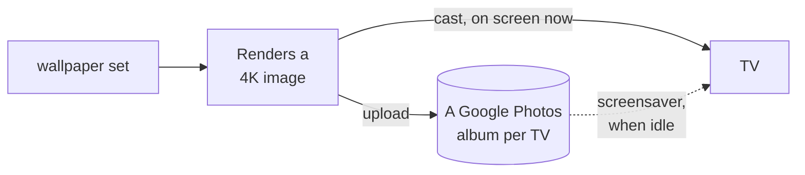

A small command-line tool on my home server for putting something on the TVs: a photo, a solid color, or a message like "Dinner's ready".

## How it works

- **It renders the image** at 3840×2160 with Pillow: the picture or color, plus text with a choice of size, color, position and backdrop. Every command is a dry run until `--apply`, which renders a preview to check first.
- **Casting puts it on screen right away**, using [catt](https://github.com/skorokithakis/catt) over the home network. It isn't permanent: the streamer drops a cast after anywhere from a few minutes to most of an hour, and anyone casting something else replaces it.
- **The album keeps it there.** Each TV has its own Google Photos album holding only the current wallpaper, and the TV's ambient screensaver shows that album whenever it's idle.
- **It leaves room for the screensaver's overlays.** Ambient mode draws the device name, the weather and clock, and the album name on top of the photo. The tool puts soft dark boxes behind those spots, so they stay readable on a bright image.

## Why it has public pages

Google only lets an app keep a sign-in for more than a week once it's published, and publishing needs a homepage and a privacy policy on a domain the app controls. Those are the two pages linked above. The app uses Google Photos with access limited to what it creates itself: its own albums and the images it uploads. It can't see the rest of the library.
