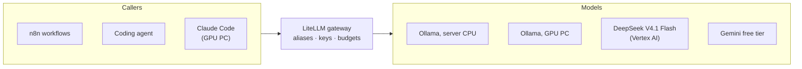
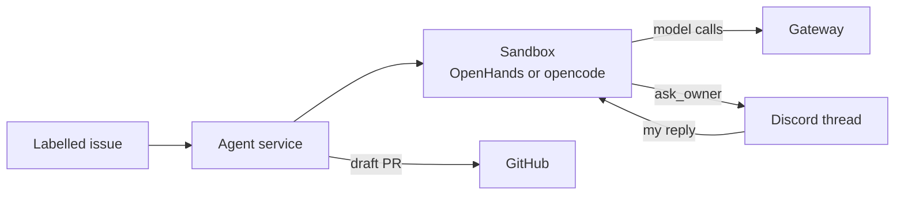

Everything that talks to a model goes through one gateway on my home server. The callers are workflows, a coding agent, and Claude Code on my PCs. The gateway decides which model actually answers. Callers ask for a role, like "a coder" or "something to name media files", and I can change the model behind that role without touching them.

Claude Code on my desktop is the one exception: it talks to Anthropic directly.

## The gateway

[LiteLLM](https://github.com/BerriAI/litellm) runs in Docker on the server. It gives everything one OpenAI-compatible endpoint, so any tool that can talk to OpenAI can talk to my models. It shares a Postgres database with n8n.

Models are reached by **alias**, not by name:

| Alias | What answers |
|---|---|
| *general, local* | A small Gemma model on the server's CPU |
| *general, GPU* | Gemma with a 128k context on the GPU PC. It falls back to the server's CPU when the PC is asleep. |
| `media-classify` | The model that names media downloads, on the server's CPU, falling back to the GPU PC |
| `embed` | `nomic-embed-text`, on a second Ollama on the server so embedding never pushes the naming model out of memory |
| `coder` | gpt-oss-20b on the GPU PC, the coding agent's local model |
| `coder-cloud` | DeepSeek V4.1 Flash on Vertex AI, the coding agent's cloud model |
| `cloud-manual-coder` | The same DeepSeek model, kept as a separate alias for Claude Code run by hand |

The two cloud aliases have the same model today. They're separate so either one can change without the other.

**Every caller gets its own key.** A key lists the aliases it may use and has a budget that resets every 30 days. When the budget runs out, the gateway refuses that key until the reset, so a runaway loop costs a capped amount. Everything else on Vertex AI is switched off in the gateway's config, so nothing can reach a model there by accident.

The gateway also keeps every prompt and reply, for a later project on what I actually use these models for.

## The coding agent

To hand a task to the agent, I put a label on a GitHub issue in one of my infrastructure repos. The label picks the local or the cloud model.

Then:

1. A webhook reaches a small service on the server, which checks GitHub's signature.
2. The service clones the repo and starts a fresh sandbox container on its own Docker daemon. The agent inside is [OpenHands](https://github.com/All-Hands-AI/OpenHands) or [opencode](https://github.com/sst/opencode). The sandbox has no GitHub credentials and can reach only the gateway and the internet, nothing else on my network. A job gets up to an hour.
3. If the agent needs a decision, it calls an `ask_owner` tool. The question goes through n8n into a Discord thread, and my reply in that thread goes back to the waiting job.
4. When it finishes, the service checks the result. It refuses changes to CI workflows or `.env` files, and changes without a summary. Otherwise it pushes a new branch and opens a **draft** PR that closes the issue. It pushes and comments as its own GitHub App, so I can review and approve its PRs like anyone else's.

Every commit the agent makes ends with a trailer naming the tool and the real model behind the alias. Every PR description ends with a matching footer. The service adds them if the agent forgets.

## n8n

[n8n](https://n8n.io/) runs the workflows that aren't code:

- **Media naming.** When a download finishes, a workflow asks `media-classify` for the title, year and season, and a small API moves the file into the right library. Anything it isn't sure about is left for me to check.
- **Shared memory.** Any agent in n8n can get "remember" and "recall" tools backed by [Chroma](https://www.trychroma.com/). Memories that came from web pages, emails or files are marked untrusted when recalled.
- **Infrastructure search.** A service re-indexes my infrastructure repos (docs, configs and scripts, never secrets) into Chroma within about a minute of a change. A "network lookup" tool answers questions with excerpts that name the repo and file they came from.
- **The coding agent's messages,** as above.

## Claude Code

On my desktop, [Claude Code](https://claude.com/claude-code) is the main way I work: on these repos, on this site, and on the plans behind them. It follows the same attribution rule as the coding agent: every commit and PR says which model wrote it.

On the GPU PC there's a second setup. A `cloud-code` command runs Claude Code against the gateway's `cloud-manual-coder` alias instead of Anthropic's API. That's DeepSeek doing the work through Claude Code's tools, under its own budgeted key.

## Around it

- **CI.** A self-hosted Forgejo mirrors the GitHub repos and runs their checks. A merge to the server's repo deploys only if every check passed. Deploys run one at a time, and results show on the GitHub PR.
- **Discord.** A small bot keeps one outbound connection to Discord, so nothing is exposed to the internet. It starts a thread per job or topic, and its mentions can only ever reach me.
- **Dashboards.** Grafana shows requests per model, spend per day, each key's budget, and how many agent jobs are running or waiting on me.

## What's next

- Claude Code opening its PRs as its own GitHub bot, the way the coding agent does, so my approvals mean something on those too.
- Looking through the stored prompts to see which tasks the local models handle well enough and which need the cloud.
